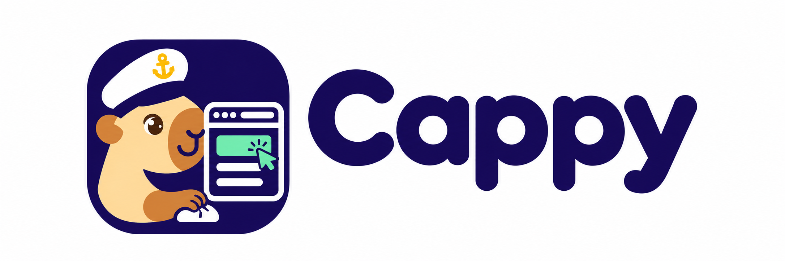
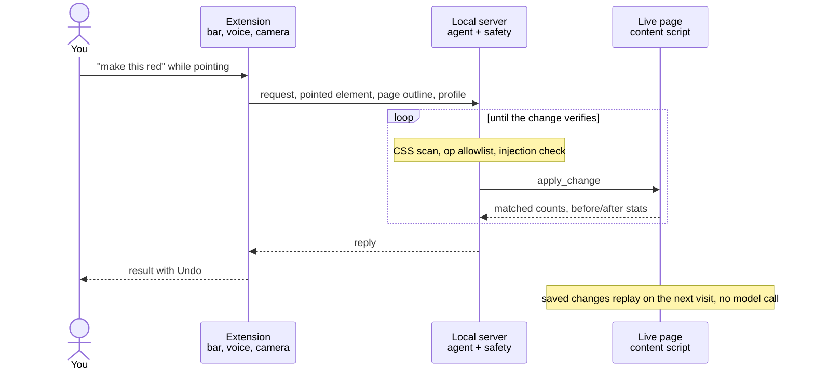

# Cappy (your loyal captain of web browsing)

Take control of the web with AI agents.

A Chrome extension that adapts the website you're on to how you need it. Built at HackUMass XIV.

[](https://www.youtube.com/watch?v=xg5TxgsSfbc)

Watch the demo: [youtu.be/xg5TxgsSfbc](https://www.youtube.com/watch?v=xg5TxgsSfbc)

## The problem

Most websites are built for one kind of user. If you're colorblind, sensitive to bright pages, have low vision or a tremor, or lose focus in a busy feed, you end up working around the page instead of using it. Site settings differ everywhere, and browser zoom often breaks the layout.

This extension lets you change the page yourself. You say what you need, or point at something and say it, and an agent edits the live page. It checks the result against the page's own stats and reverts anything that made it worse. Anything it learns about you is saved only after you approve it.

## Your feed, your rules

Most sites decide what you see and in what order. Here you can change that on the live page.

- Rerank what a site recommends: sort videos, posts or results by what you care about. The agent reads each item with `list_items` and reorders them, or sorts alphabetically. Stories that span several rows, like Hacker News, move as one unit, and items that load later join the sort.
- Filter or hide content: "hide podcasts", "dim anything about crypto", "hide Shorts". Filters match item text and keep applying as the page loads more. Shorts are judged by format, so a whole shelf goes with its heading, and verdicts are saved per site so an item is not judged again. After every filter Cappy counts the matching links still on screen, so it cannot say something is hidden while it shows.
- Time-based rules: "hide Shorts and gaming videos on weekdays 9am to 5pm", "dark mode after 10pm", "until December 15". The bar and Settings show each rule's schedule and whether it's on right now. While a rule is on, the bar shows Focus. Turn on Focus mode in Settings to keep every focus rule on, whatever the time, until you turn it off.

## Features

- Plain-language requests like "dim this page", "hide podcasts" or "make the form easier". The agent writes CSS, uses an allowlisted DOM operation, or runs one of the built-in blocks: dark mode, colorblind filter, text scaling, stop motion, content filter and form fixer.
- Point and speak. Hover the mouse or point with a camera hand pointer and say "make this red". With the camera you can pinch and hold to select, then let go to send.
- Voice input stops after a short pause, when you say "done", or at 15 seconds. A ring shows when it's about to send.
- Dark mode keeps chart legends and dark boxes readable when it inverts a page, and a page that is already dark is left alone.
- Talk with Cappy using GPT-Live: pick "GPT-Live conversation" in Settings, Voice. It listens and talks back, keeps talking while the page changes, and you can interrupt it. Needs an OpenAI API key.
- Friction detection. Repeated zooming or missed clicks on small targets produce one suggested fix, and the suggestions adjust to what you accept, dismiss or undo.
- Memory with consent. Each preference asks whether it applies to this site, all sites, or neither, and your answer decides where the change applies. Earlier all-sites changes stay put when you answer a new prompt.
- Hands-free control with an air pointer, pinch or dwell click, hand and head scrolling, and swipes for back and forward.
- Every change can be undone from the toast or the change history, and one switch pauses all of them. A one-off change stays on the page you made it on. Say "on this site" or "on all sites" to keep it wider, even in a sentence that also says "on this page".
- Setup on first install: connect an AI, pick your needs, try the shortcut and allow the microphone. Settings can open it again.
- Profiles: type `/profile` in the bar to create or switch profiles, such as one for study and one for a family member. Each keeps its own preferences, saved changes and history.
- `/always <request>` saves a command that runs once on each new site you visit.
- Import and export from Settings to move profiles, preferences, saved changes, commands, and request history between computers. Export a JSON file on one computer, then import it on the other. Import replaces the current config; API keys, sign-ins, and the local server address stay on each computer.

## How it works



Each request runs as one tool-use loop. The agent reads an outline of the page, applies a change, looks at how many elements matched and how the accessibility stats moved, then keeps, fixes or reverts the change. Saved changes replay on page load without a model call, about 0.2 seconds for 12 of them on a feed-sized page. A new site gets one model check per profile, with the page blurred for at most 1.5 seconds, and later visits skip it. API keys stay on the local server and never ship in the extension.

## Models

Cappy runs on ChatGPT, Claude, OpenAI or Gemini. Each provider has a Fast and a Pro model. In Auto, Fast goes first and Pro takes over when Fast calls `escalate` or its changes fail. Tab in the bar cycles Auto, Fast and Pro.

In our tests the GPT-6 family was the most accurate on page edits. Gemini was cheaper and faster but less accurate. Its defaults are `gemini-3.6-flash` for Fast and `gemini-4-hydrogen` for Pro. In a six-request check against the real agent prompt, they got 11 and 10 of 12 right, at about 8 seconds a request. Set `GEMINI_MODEL_FAST` and `GEMINI_MODEL_FRONTIER` in `.env` to change them.

## Safety

- The model never writes JavaScript. CSS is scanned before use, and DOM operations and attributes come from an allowlist.
- Page text is untrusted. An injection check runs before any model call, and a hit blocks all changes on that page.
- The model sees short profile lines and friction counts. It does not see your browsing history or text from other sites.

## Let your coding agent install it

You do not have to run the install commands yourself. Paste this into the coding agent you already use:

```
Run curl -fsSL https://raw.githubusercontent.com/Riddhimaan-Senapati/cappy/main/skills/install-cappy/SKILL.md and follow the instructions in its output to install and run Cappy.
```

That fetches [skills/install-cappy/SKILL.md](skills/install-cappy/SKILL.md), which gives the agent each step.

If the agent loads skills from the skills library, install the same skill with:

```
npx skills add Riddhimaan-Senapati/cappy
```

[`skills.sh.json`](skills.sh.json) groups that skill on the skills.sh page.

## Run it

```bash
bun install
bun run build:ext
bun server/index.ts
```

Load `extension/` unpacked at `chrome://extensions`, sign in with ChatGPT or add an API key from the extension popup, then press Cmd/Ctrl+Shift+Space on any page. `http://localhost:8787/demo/campus.html` is a good page to try it on.

Tests: `bun run typecheck`, `bun run test` and `bun run e2e`. The e2e suite needs port 8787 free.

Engineering details are in [CLAUDE.md](CLAUDE.md).

Set `log_llm_requests=true` in `.env` to save each LLM request and response as YAML in `llm_logs/` (off by default). Logs wrap near 100 columns and replace large request content (1,000+ characters) with placeholders such as `{{html__size_100_000}}`. The actual LLM input is unchanged. Restart the server after changing `.env`.

Open [the local LLM log viewer](http://localhost:8787/) to browse requests as step-by-step timelines, inspect tool calls and results, read condensed text, and preview screenshots. Full exchanges and system prompts are available in expandable sections. New screenshot attachments are stored once by content in `llm_logs/images/`; older image placeholders cannot be restored. New agent runs are grouped by run ID; existing logs are grouped from their conversation history.
